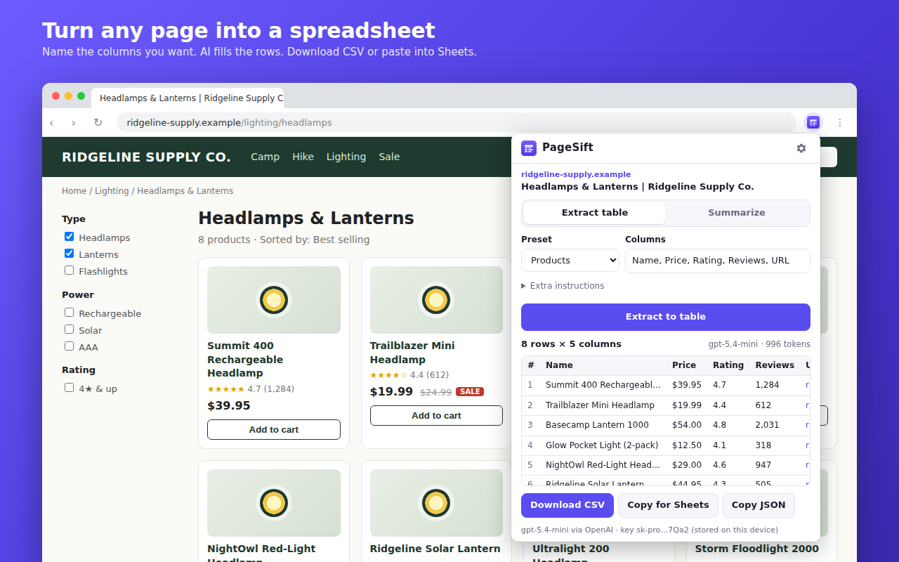
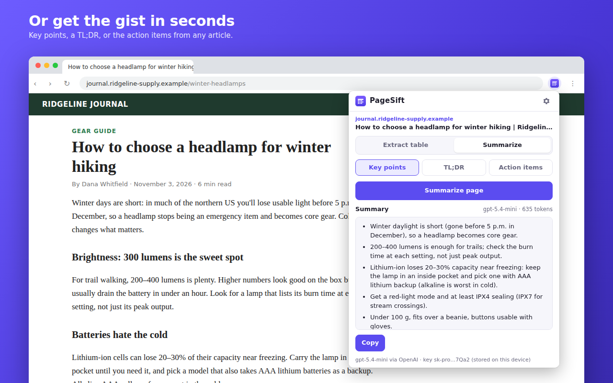
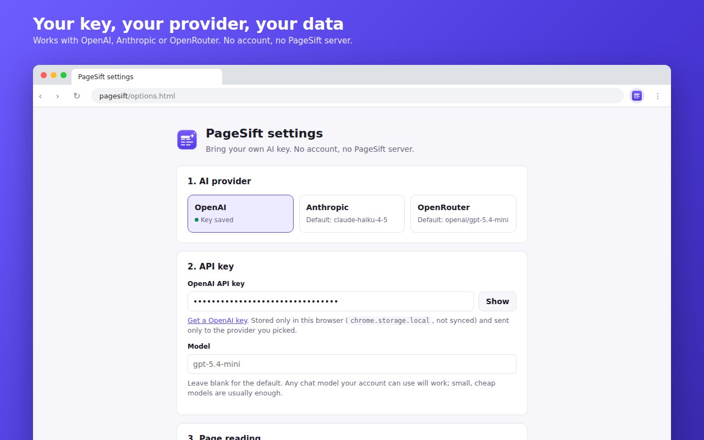
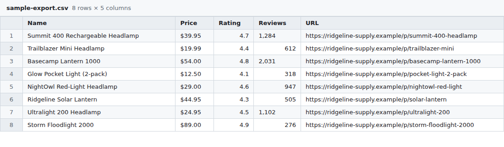

# PageSift: AI page to CSV & summary (Chrome extension)

  

A Manifest V3 Chrome extension that turns the page you're looking at into a **clean CSV table**
(you name the columns, AI fills the rows) or a **short summary**, using **your own** OpenAI,
Anthropic or OpenRouter API key. No account, no backend, no keys bundled.



**Why this idea:** "page → spreadsheet" is the most common request behind Chrome-extension and scraper gigs, and it
exercises every part buyers pay for: MV3 service worker, `activeTab` page access, a structured-output AI call and file export.
It's also useful on its own with zero running cost (bring-your-own key), so it can grow into a freemium product without a rewrite.

## Features

- **Extract to table.** Type columns (`Name, Price, Rating, URL`) or pick a preset: products,
  articles, events, job listings, or "main table on the page". Leave columns blank and the model
  chooses them. Optional extra instructions ("only items in stock").
- **Structured output, not regex.** OpenAI/OpenRouter use strict `json_schema` responses; Anthropic
  uses a forced tool call. Replies are validated and normalised into a rectangular table.
- **Export:** Download CSV (UTF-8 BOM for Excel, formula-injection safe), **Copy for Sheets** (TSV),
  or Copy JSON. Files are named like `pagesift-shop.example.com-2026-11-07.csv`.
- **Summarize:** key points, TL;DR, or action items (deadlines, prices, decisions).
- **Selection-aware:** select part of a page first to send only that part.
- **Survives closing the popup:** the request runs in the service worker, and the result is kept
  per tab in `chrome.storage.session`, with a row-count badge on the icon.
- **Safe with untrusted pages:** page text is fenced and the model is told to treat it as data,
  not instructions. Results are rendered with `textContent`, never `innerHTML`.
- Light and dark mode; keyboard shortcut <kbd>Alt</kbd>+<kbd>Shift</kbd>+<kbd>S</kbd>.

| Summarize | Settings (bring your own key) |
|---|---|
|  |  |

The exported CSV from the first screenshot ([`docs/sample-export.csv`](docs/sample-export.csv), produced by the shipped `toTable`/`toCSV` code):



## Permissions and privacy

| Permission | Why |
|---|---|
| `activeTab` | Read the current tab only after you click the icon. No `<all_urls>`, no background access. |
| `scripting` | Inject one self-contained function (`collectPage`) on click to grab visible text and links. No static content scripts. |
| `storage` | Settings and key in `chrome.storage.local` (never `sync`); per-tab results in `chrome.storage.session`. |
| Optional: `api.openai.com`, `api.anthropic.com`, `openrouter.ai` | Requested at runtime **only for the provider you pick** (extension pages need it to call the API). Nothing at install. |

There's no PageSift server, no analytics and no remote code (`script-src 'self'`). The page text goes
from your browser straight to the provider you chose. Full policy: [`src/privacy.html`](src/privacy.html)
(also shipped inside the extension). "Delete all PageSift data" in Settings wipes storage and
revokes the API permission.

## Install (unpacked)

```bash
npm ci && npm run build
```

1. Open `chrome://extensions`, turn on **Developer mode**.
2. **Load unpacked** → pick `dist/extension/`.
3. Click the PageSift icon → **Add API key**, choose a provider, paste your key, **Save** (Chrome asks
   once to allow that provider's API), optionally **Test key** (uses a free endpoint, no tokens).
4. Open any page, click the icon, **Extract to table**.

Cost is whatever your provider charges: with a small model (default `gpt-5.4-mini`,
`claude-haiku-4-5`, or any OpenRouter model) a typical page is a fraction of a cent. The default cap
sends at most 30,000 characters per request (adjustable from 2k to 120k).

## How it works

```
popup.ts ──click──▶ chrome.scripting.executeScript(collectPage)   (activeTab, on demand)
   │                     └─▶ PageSnapshot {url, title, text, links, fromSelection}
   │  snapshotToPromptText(): budget-aware truncation (links ≤ 25% of budget)
   └─ runtime.sendMessage({type:"run", job}) ─▶ background.ts (service worker)
                                                  runJob(): prompt.ts → providers.ts (OpenAI | Anthropic | OpenRouter)
                                                  → table.ts (normalise) → storage.session["run:<tabId>"]
popup.ts ◀── storage.onChanged ── renders table / summary, exports CSV / TSV / JSON
```

All logic is in `src/lib/` as pure functions with no `chrome.*` calls (except the storage helpers,
which take the storage area as a parameter), so it's covered by fast unit tests. Provider
differences (auth headers, `max_completion_tokens` vs `max_tokens`, JSON schema vs tool use,
refusals, truncation, 401/402/429/5xx) live in one adapter, `providers.ts`.

## Development

```bash
npm run typecheck     # tsc --noEmit (strict)
npm test              # node:test on the TypeScript sources (Node ≥ 22.18, no test framework)
npm run build         # esbuild → dist/extension/ (readable, unminified, for store review)
npm run package       # typecheck + test + build + dist/pagesift-<version>.zip
npm run smoke         # load the zip in a throwaway headless Chrome; check SW, pages, storage, error path
npm run watch         # rebuild on change
npm run screenshots   # store screenshots (needs .venv with Pillow; uses a temporary Chrome profile)
```

Test run (Node 24, 56 tests):

```
ℹ tests 56
ℹ suites 0
ℹ pass 56
ℹ fail 0
```

```
src/
  manifest.json        MV3; version is stamped from package.json at build time
  background.ts        service worker: runs jobs, cancels, stores results, badge
  popup/  options/     UI (plain DOM + CSS, no framework)
  privacy.html         privacy policy (shipped, and the page to host for the store)
  lib/
    page.ts            collectPage() (injected) + prompt-budget truncation
    prompt.ts          prompts + JSON schemas (fixed columns or model-chosen)
    providers.ts       OpenAI / Anthropic / OpenRouter adapters, errors, key check
    run.ts             one job end to end → RunState
    table.ts           normalise rows, CSV/TSV/JSON export, formula-injection guard
    columns.ts settings.ts plan.ts text.ts
tests/                 unit tests (fake fetch for all three providers) + manifest policy checks
demo/                  fictional pages, chrome.* stub and canned replies for screenshots
store/                 listing copy, store icon, 1280×800 screenshots, promo tile
scripts/               build, package (dependency-free zip), smoke, screenshots, icons
```

## Freemium path

`src/lib/plan.ts` is the single switch: `getPlan()` returns limits (characters per request,
columns, saved templates) and `setPlanSource()` lets a licence check plug in, e.g.
[ExtensionPay](https://extensionpay.com)'s `getUser().paid`, with a fallback to free when the check fails.
Free stays fully useful with your own key. Pro candidates: saved extraction templates per site,
multi-page runs (follow "next" links), scheduled re-extraction with change alerts, Google Sheets
append, and a hosted key so non-technical users don't need an API account.

## Publishing checklist (not done; owner decision)

Nothing has been published or submitted. To ship it:

1. **Chrome Web Store developer account**: one-time **US$5** registration fee, a Google account with
   2-step verification, and a verified contact email. Decide whether to publish as an individual or
   as Breezy Development, and complete the **trader / non-trader** declaration (EU Digital Services Act).
2. **Host the privacy policy** at a public URL (e.g. GitHub Pages, or a page on the Breezy site),
   using `src/privacy.html`.
3. `npm run package` → upload `dist/pagesift-1.0.0.zip`.
4. Paste the listing text, permission justifications and data-use answers from
   [`store/listing.md`](store/listing.md); upload `store/icon-store-128.png`, the three 1280×800
   screenshots and the 440×280 promo tile.
5. Submit for review (often a few days). The permissions are minimal and the "website content" data
   use is declared up front. Consider **Unlisted** first and share the link from the Fiverr gig.
6. Optional: a public GitHub repo (the CI workflow in `.github/workflows/tests.yml` is ready), and
   a real end-to-end check with a funded API key before launch (only the invalid-key path has been
   exercised against a live API).

## About the screenshots

The store screenshots show the real `popup.html` and `options.html` rendered in a normal tab, with
the real `background.js` alongside, and `demo/chrome-stub.js` standing in for the `chrome.*` APIs.
The page being read is a fictional store/article (`demo/*.html`), and the **AI reply is canned**
(`demo/canned-*.json`, in OpenAI's response format). Page reading, prompt building, response
parsing, table rendering and the CSV are the shipped code. Rendered by `scripts/screenshots.py`
with a throwaway headless Chrome profile.

## About

Built by Breezy Development with AI-assisted development; every line is reviewed and
tested by a human before it ships.

## License

[MIT](LICENSE)
